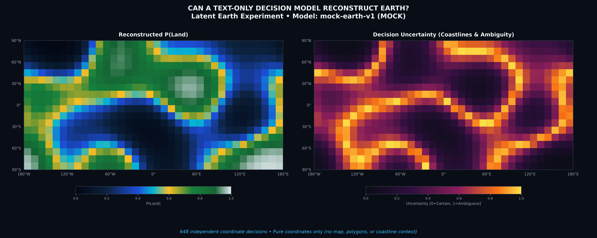

# Latent Earth

Can a text-only decision model reconstruct the shape of Earth?

This experiment asks a decision model one simple question thousands of times:

> **"Is this latitude/longitude coordinate located on land rather than water?"**

Each query is completely independent. The model receives no map, no image, no neighboring predictions, and no geographic database. Its answers and calibrated probabilities are then plotted back into coordinate space, reconstructing the continents purely from latent weights.



---

## Key Questions & Scientific Scope

Decision models like **TypeSafe Jev** are trained to provide fast, calibrated, structured decisions (System One judgments) rather than generating conversational prose. This experiment asks:

1. **Latent World Structure:** How much global coastline and continental geometry is encoded in a text-only decision model without retrieval or spatial priors?
2. **Probability Calibration:** Does model uncertainty peak naturally along continental coastlines, archipelago chains, and inland seas?
3. **Model Agnosticism:** How do different model families (Jev System One vs. generative LLMs like Qwen / Llama / GPT) compare when querying the same geographic grid?

> **Scientific Limitation Note:**  
> This experiment demonstrates learned geographic correlation and spatial resolution embedded in pre-trained weights. It does **not** by itself establish that the model possesses an explicit internal simulation or "world model" in a formal theoretical sense.

---

## Grid Resolutions & Scale

Using an equal-angle cell-centered grid covering $[-90^\circ, +90^\circ]$ latitude and $[-180^\circ, +180^\circ)$ longitude:

| Resolution | Latitudes | Longitudes | Total Queries | Typical Use Case | Approx. Jev Cost |
| :--- | :--- | :--- | :--- | :--- | :--- |
| **Smoke Test** | Custom | Custom | 10 – 30 | Sanity check, auth, API schema verification | < $0.0001 |
| **10° Grid** | 18 | 36 | **648** | Rapid global sanity check (continents recognizable) | ~$0.0016 |
| **4° Grid** | 45 | 90 | **4,050** | High-fidelity continental borders, major islands | ~$0.0102 |
| **2° Grid** | 90 | 180 | **16,200** | Publication & social-media quality | ~$0.0408 |

---

## Installation

Using [`uv`](https://docs.astral.sh/uv/) (recommended for speed and reproducibility):

```bash
git clone https://github.com/your-username/latent-earth.git
cd latent-earth

# Install dependencies and local CLI
uv sync
```

Or using standard `pip`:

```bash
pip install -e .
```

---

## Quickstart

### 1. Offline Mock Pipeline (Zero Cost, No API Key Required)

Test the complete grid generation, async execution, caching, and visualization pipeline using the deterministic mock provider:

```bash
# Run a 10-degree global mock run (648 decisions)
uv run latent-earth run --provider mock --step 10

# Inspect the outputs generated in outputs/
ls -lh outputs/
```

This immediately creates:
- `outputs/mock_mock-earth-v1_10deg_mock-v1.jsonl` (incremental cache)
- `outputs/mock_mock-earth-v1_10deg_mock-v1_binary.png` (binary Land / Water)
- `outputs/mock_mock-earth-v1_10deg_mock-v1_probability.png` (continuous P(Land))
- `outputs/mock_mock-earth-v1_10deg_mock-v1_uncertainty.png` (decision uncertainty)
- `outputs/mock_mock-earth-v1_10deg_mock-v1_composite.png` (high-res composite)
- `outputs/mock_mock-earth-v1_10deg_mock-v1_composite_clean.png` (headless composite)

---

## Live Experiments with TypeSafe Jev

### Setup API Key

Get your API key from the [TypeSafe Console](https://console.typesafe.ai):

```bash
export TYPESAFE_API_KEY="your-typesafe-api-key"
# or add it to a local .env file
```

### Stage 1: Tiny Smoke Test (20 coordinates)

Always verify authentication, response schema, and probability calibration with a tiny smoke test before larger runs:

```bash
uv run latent-earth run --provider jev --step 10 --limit 20
```

### Stage 2: Coarse Global Test (10° Grid — 648 queries)

The first complete sanity check of Earth's shape (~$0.0016 API cost):

```bash
uv run latent-earth run --provider jev --step 10
```

### Stage 3: Medium Global Experiment (4° Grid — 4,050 queries)

Recognize major peninsulas, inland seas, and island groups:

```bash
uv run latent-earth run --provider jev --step 4
```

### Stage 4: Publication & Social Media Quality (2° Grid — 16,200 queries)

High-resolution global reconstruction:

```bash
uv run latent-earth run --provider jev --step 2
```

### Safe Dry-Run Inspection

Preview coordinate counts, batching plans, and cost estimates without making external calls:

```bash
uv run latent-earth run --provider jev --step 2 --dry-run
```

---

## OpenAI-Compatible LLM Providers

You can test local or hosted LLMs (vLLM, Ollama, LM Studio, or OpenAI) using the `openai_compatible` provider:

```bash
# Example with local LM Studio or vLLM at localhost:1234
uv run latent-earth run \
  --provider openai_compatible \
  --model "qwen2.5-7b-instruct" \
  --step 10
```

---

## Ground-Truth Geographic Evaluation

Evaluate the reconstructed map against official [Natural Earth 1:110m](https://www.naturalearthdata.com/) land polygons:

```bash
uv run latent-earth evaluate --input outputs/jev_jev-latest_4deg_land-water-v1.jsonl
```

Metrics computed:
- **Accuracy, Precision, Recall, F1-Score**
- **Brier Score & Log Loss** (calibration quality)
- **Confusion Matrix** (TP, TN, FP, FN)
- **Most Confidently Wrong Coordinates** (e.g. enclosed seas, small islands)
- **Most Uncertain Coordinates** ($P(\text{land}) \approx 0.5$)
- **4-Class Error Map:** Saved to `*_error_map.png`

---

## Architecture & Scientific Principles

- **Isolated Decisions:** Each coordinate is formatted independently:
  `Geographic coordinate: 45.000° N, 73.000° W (Latitude: 45.000, Longitude: -73.000)`
- **Native Boolean Probability:** Uses Jev's native `noul` primitive:
  ```json
  {
    "model": "jev-latest",
    "state": "Geographic coordinate: 45.000° N, 73.000° W ...",
    "questions": {
      "is_land": {
        "type": "noul",
        "instructions": "Is this geographic coordinate located on land rather than water?",
        "criteria": {
          "true": "The coordinate is located on land (continents, islands, landmasses).",
          "false": "The coordinate is located on water (oceans, seas, lakes)."
        }
      }
    }
  }
  ```
- **Incremental Resumability:** Predictions are flushed atomically to JSONL. If interrupted, restarting the command instantly resumes missing coordinates without duplicating API costs.

---

## License

MIT License. Open-source research demo.
